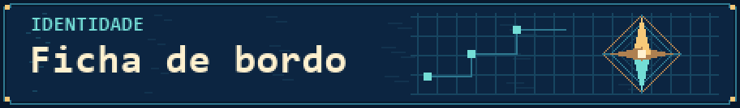
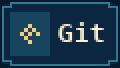
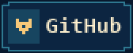
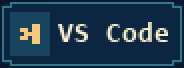
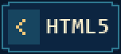
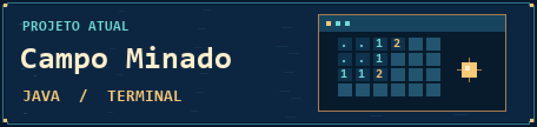

<h2></h2>

Sou estudante de <strong>cybersecurity</strong> e de <strong>desenvolvimento back-end</strong>.

<code>Foco de estudo</code> &nbsp; <strong>Java e Python</strong>

<h2></h2>

   

   

<h2></h2>

Estou desenvolvendo um <strong>Campo Minado de terminal em Java</strong>. <a href="https://github.com/Raykk0nen/Campo_Minado">Ver o código do Campo Minado ↗</a>

<h2>Maré de Ouro</h2>
