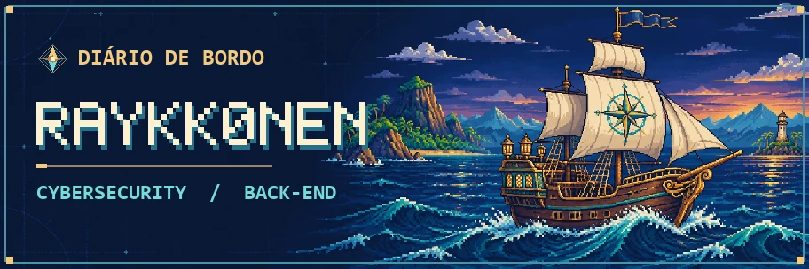
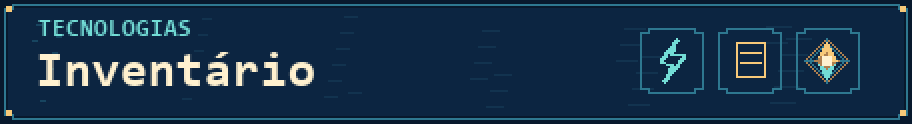
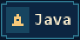
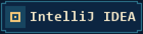
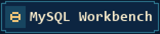
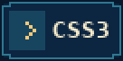
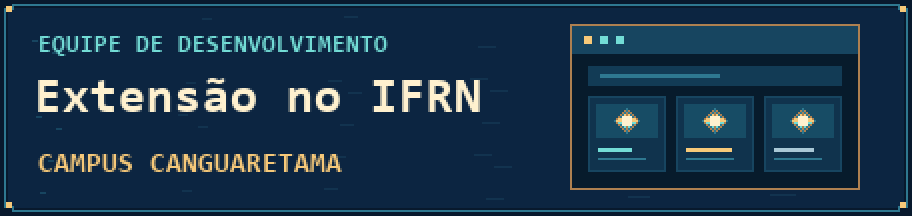
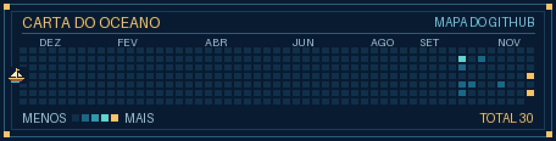
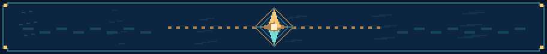

<h2></h2>

Sou estudante de <strong>cybersecurity</strong> e de <strong>desenvolvimento back-end</strong>.

<code>Foco de estudo</code> &nbsp; <strong>Java e Python</strong>

<h2></h2>

   

   

<h2></h2>

Estou desenvolvendo um <strong>Campo Minado de terminal em Java</strong>. <a href="https://github.com/Raykk0nen/Campo_Minado">Ver o código do Campo Minado ↗</a>

<h2></h2>

Faço parte da <strong>equipe de desenvolvimento</strong> da plataforma que apresenta três projetos de extensão do <strong>IFRN Campus Canguaretama</strong>. <a href="https://github.com/vicccviccc/ifrncangVRGP">Ver o projeto de extensão ↗</a>

<h2>Maré de Ouro</h2>

<picture><source media="(prefers-reduced-motion: reduce)" srcset="assets/carta-nautica.png"></picture>

O navio cruza o <a href="https://github.com/Raykk0nen#js-contribution-activity">calendário de contribuições do GitHub</a>. Os quadrados mais claros marcam os dias com mais atividade.

<a href="https://raykk0nen.github.io/Raykk0nen/">Jogar Maré de Ouro ↗</a> · Recolha 5 tesouros, desvie dos obstáculos e chegue ao porto.

Registro do calendário em 27/11/2026.

<blockquote>
“O futuro não é algo que esperamos, é algo que construímos.” — Vegapunk, One Piece
</blockquote>
